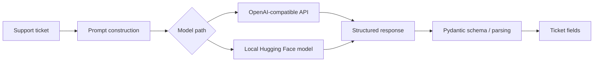

# Support Ticket Classification

An experimental Python project for turning free-form customer support messages into structured ticket information with language models.

The project explores two model paths: OpenAI-compatible chat APIs and local Hugging Face causal language models. It also includes prompt helpers, Pydantic schemas, structured generation with Outlines, retry handling, sample data, and evaluation utilities.

## Why this project?

Support requests often arrive as unstructured text, while support workflows need consistent information to route and prioritize each issue. This project explores extracting a small set of useful fields from each message:

- **Category** — technical, account, delivery, billing, or subscription
- **Sentiment** — positive, negative, or neutral
- **Urgency** — low, medium, or high
- **Summary** — a concise description of the customer’s issue

### Example

**Ticket**

> My laptop screen is broken and I need urgent help.

**Intended result**

```json
{
  "category": "technical",
  "sentiment": "negative",
  "urgency": "high",
  "summary": "The customer reports a broken laptop screen and needs urgent help."
}
```

## Project flow



The repository contains experiments for these pieces. The API and local inference paths are separate implementations and are not yet connected through one polished end-to-end application.

## Capabilities and components

| Component | Location | Description |
| --- | --- | --- |
| API provider interface and adapters | `Api/` | Common LLM abstraction and OpenAI-compatible provider implementations |
| Retry gateway | `Api/gateway.py` | Retries selected transient provider errors with randomized backoff |
| Ticket classifier service | `Api/Ticket_classifer.py` | Builds a classification request and sends the response through validation |
| Prompt helpers | `prompt/` | Classification and other task prompt construction |
| Structured output | `src/structered/` | Outlines integration and Pydantic ticket schemas |
| Local model inference | `src/infernce/` | Hugging Face model loading, tokenization, decoding, and generation |
| Evaluation utilities | `evaluation/` | Evaluation-related model and metric code |
| Example data | `data/tickets.csv` | Small example ticket dataset |
| Experiments | `notebook/` | Jupyter notebooks used during development |

## Tech stack

- Python
- Hugging Face Transformers and PyTorch
- OpenAI Python SDK for OpenAI-compatible services
- Pydantic and Pydantic Settings
- Outlines for constrained structured generation
- Jupyter notebooks for experiments

## Getting started

### Requirements

- Python 3.10 or newer
- Git
- A Hugging Face model for local inference, or an API key and model name for an OpenAI-compatible provider

### Install

Clone the repository and enter its folder:

```bash
git clone https://github.com/shehabahmedd17-gif/support-ticket-classification.git
cd support-ticket-classification
```

Create and activate a virtual environment.

**Windows Command Prompt**

```cmd
python -m venv .venv
.venv\Scripts\activate
```

**macOS / Linux**

```bash
python3 -m venv .venv
source .venv/bin/activate
```

Install the Python dependencies:

```bash
python -m pip install --upgrade pip
python -m pip install -r requirement.txt
```

PyTorch installation can depend on your operating system and hardware. If the default install does not match your machine, use the appropriate command from the official PyTorch installation selector.

### Configure environment variables

Copy the sample file to `.env` and edit it with your own values.

**Windows Command Prompt**

```cmd
copy .env.example .env
```

**macOS / Linux**

```bash
cp .env.example .env
```

| Variable | Required for | Description |
| --- | --- | --- |
| `LLM_api_key` | API path | API key for the selected provider |
| `LLM_model` | API path | Provider model identifier |
| `LLM_base_url` | API path | OpenAI-compatible endpoint; defaults to Groq's API endpoint |
| `LLM_max_attempts` | API settings | Configured retry attempt count |
| `LMM_base_delay` | API settings | Base retry delay in seconds; variable name matches current code |
| `LLM_timeout` | API settings | Request timeout in seconds |
| `MODEL_NAME` | Local inference | Hugging Face model identifier or local model path |
| `DEVICE_MAP` | Local inference | Optional Transformers device map; defaults to `auto` |
| `TORCH_DTYPE` | Local inference | Optional model dtype; defaults to `auto` |

Never commit real API keys or private customer data. `.env` and local model artifacts are excluded by `.gitignore`.

## Ticket output fields

The intended structured result follows the ticket schema in `src/structered/schema.py`:

| Field | Description | Expected values |
| --- | --- | --- |
| `category` | Ticket issue type | `technical`, `account`, `delivery`, `billing`, `subscription` |
| `sentiment` | Customer sentiment | `positive`, `negative`, `neutral` |
| `urgency` | Priority level | `low`, `medium`, `high` |
| `summary` | Brief description | Free-form text |

## Repository layout

```text
.
├── Api/             # Provider interfaces, adapters, settings, retry gateway
├── data/            # Example ticket data
├── evaluation/      # Evaluation utilities
├── notebook/        # Exploratory notebooks
├── prompt/          # Prompt templates and builders
├── src/
│   ├── infernce/    # Local model inference utilities
│   └── structered/  # Structured generation and ticket schema
├── tests/           # Existing project test scripts
├── .env.example     # Configuration template
├── .gitignore       # Excludes secrets and generated/local files
└── requirement.txt  # Python dependencies
```

Some directory names retain their original spelling (`infernce`, `structered`, and `requirement.txt`).

## Current status and limitations

This is an in-progress project. It currently provides experimental modules and notebooks rather than a packaged command-line tool, web application, or deployed service. The API and local-model paths need further integration and end-to-end validation before production use. Dependencies such as PyTorch and model weights can also be large and may require hardware-specific setup.

## Roadmap

- Provide a single documented command that classifies a ticket end to end.
- Align and validate the schema across the API and local-model paths.
- Add automated tests for parsing, provider calls, and retry behavior.
- Expand evaluation with a representative dataset and clear quality metrics.
- Package the application for easier installation and reuse.

## Security and data

- Keep API credentials in a local `.env` file; do not commit secrets.
- Use synthetic or properly authorized ticket data in examples and notebooks.
- Review notebook outputs before publishing because they may contain local paths or sensitive content.

## License

No license has been added yet. Until one is included, assume the project is not licensed for reuse or redistribution.
